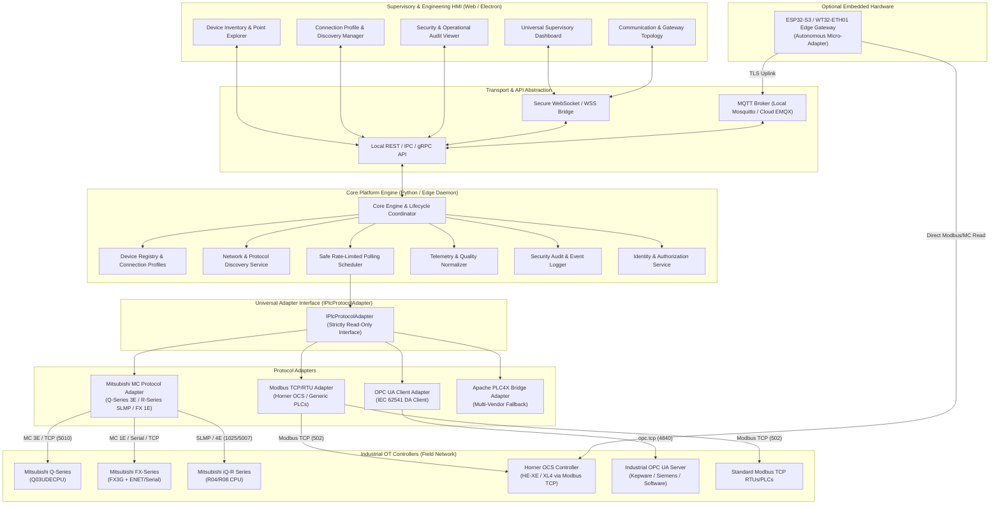

# UNIVERSAL PLC PLATFORM ARCHITECTURE AUDIT & TARGET SPECIFICATION
**Phase 01 Deliverable: Architectural Audit, Protocol Evaluation, and Migration Blueprint**

- **Document Version:** 1.0.0
- **Classification:** Engineering Architecture & OT Cybersecurity Specification
- **Auditor / Architect:** Senior Industrial Automation Software Architect & OT Cybersecurity Specialist
- **Date:** October 19, 2026
- **Status:** Complete / Approved for Strategy Review

---

## Executive Summary

This audit assesses the existing repository (`SurajYadavx/mitsubishi-q-plc-app`) and outlines an evolutionary, non-destructive migration path from a single-target supervisory monitor (tailored exclusively for a Mitsubishi Q03UDECPU PLC) to a **Universal, Multi-Vendor, Read-Only Industrial PLC Monitoring Platform**.

The current codebase is functional, strictly read-only, and verified with deterministic offline unit tests. However, it is tightly coupled end-to-end to Mitsubishi Q-series hexadecimal addressing (`X0–X7`, `Y20–Y27`), MC Protocol 3E binary frames, hardcoded MQTT topics (`plcmon/plc-gw-01/#`), and a fragile hardware daisy-chain (Windows host &rarr; USB Serial &rarr; ESP8266 &rarr; Wi-Fi &rarr; EMQX Cloud). 

This document provides a comprehensive audit of the current implementation, evaluates candidate industrial communication protocols (Mitsubishi MC/SLMP, Modbus TCP, OPC UA, Apache PLC4X), establishes an enforceable read-only threat model, proposes a decoupled target architecture with a common adapter interface, and presents a multi-phase migration roadmap that preserves operational stability without breaking current capabilities.

---

## Table of Contents

- [Section A: Current-State Architecture and Repository Inventory](#section-a-current-state-architecture-and-repository-inventory)
- [Section B: Proposed Target Architecture & Communication Flows](#section-b-proposed-target-architecture--communication-flows)
- [Section C: Protocol Compatibility Matrix & Technical Evidence](#section-c-protocol-compatibility-matrix--technical-evidence)
- [Section D: Recommended Common Adapter Interface & Normalised Data Models](#section-d-recommended-common-adapter-interface--normalised-data-models)
- [Section E: Device Discovery Strategy & Physical OT Limitations](#section-e-device-discovery-strategy--physical-ot-limitations)
- [Section F: Local-Only vs. Remote-Access Deployment Analysis](#section-f-local-only-vs-remote-access-deployment-analysis)
- [Section G: Secure Saved-Connection & Gateway Identity Design](#section-g-secure-saved-connection--gateway-identity-design)
- [Section H: Edge Compute Strategy: ESP8266/ESP32 & Windows Edge Agent](#section-h-edge-compute-strategy-esp8266esp32--windows-edge-agent)
- [Section I: Read-Only Security Threat Model & Enforcement Plan](#section-i-read-only-security-threat-model--enforcement-plan)
- [Section J: Multi-Tier Test Strategy & Empirical Verification](#section-j-multi-tier-test-strategy--empirical-verification)
- [Section K: Migration Matrix: Reuse, Refactor, Replace, Retire](#section-k-migration-matrix-reuse-refactor-replace-retire)
- [Section L: Phased Implementation Roadmap & Acceptance Gates](#section-l-phased-implementation-roadmap--acceptance-gates)
- [Section M: Blocking Questions & Laboratory Dependencies](#section-m-blocking-questions--laboratory-dependencies)

---

## Section A: Current-State Architecture and Repository Inventory

### A.1 Architectural Overview of the Existing System

The existing application is structured as a 5-tier passive telemetry pipeline:

```
[ Tier 1: PLC ]          Mitsubishi MELSEC-Q Q03UDECPU (192.168.3.39:5010)
       │                 MC Protocol 3E Binary Frame (TCP)
       ▼
[ Tier 2: Gateway ]      Windows Laptop Python Daemon (gateway/gateway.py)
       │                 pymcprotocol batchread_bitunits (0x0401)
       ▼
[ Tier 3: Edge Bridge ]  NodeMCU ESP8266 (firmware/plc_monitor/plc_monitor.ino)
       │                 USB Serial (COM9 @ 115200 baud) -> Wi-Fi MQTTS (Port 8883)
       ▼
[ Tier 4: Cloud Broker ] EMQX Cloud Serverless Cluster
       │                 Topic: plcmon/plc-gw-01/#
       ▼
[ Tier 5: Web Console ]  Static GitHub Pages Frontend (web/index.html & app.js)
                         MQTT.js over Secure WebSockets (WSS Port 8084)
```

### A.2 Repository Inventory and Structural Breakdown

| Directory / File | Type / Language | Operational Purpose | Key Dependencies | Coupling / Limitations |
|---|---|---|---|---|
| `gateway/gateway.py` | Python 3.11 | Host gateway daemon; coordinates polling loop, serialization, and serial publishing. | `pyserial`, `plc_reader.py`, `serial_publisher.py` | Hardcoded loop rate (`1.0s`), hardcoded to single gateway ID (`plc-gw-01`) and single PLC target. |
| `gateway/src/plc_reader.py` | Python 3.11 | PLC protocol driver. Connects via 3E binary frame over TCP and reads bit devices. | `pymcprotocol` | Exclusively supports MC Protocol 3E. Address parser hardcoded to Q-series hex base-16 for X/Y/B/W. |
| `gateway/src/serial_publisher.py` | Python 3.11 | Newline-delimited JSON formatter and serial writer. | `pyserial` | Couples gateway output to serial COM port. No direct network/MQTT publishing capability. |
| `gateway/config/settings.ini` | INI Config | Configuration for PLC IP/port, serial COM port, poll timing, and device lists. | Standard library `configparser` | Static point lists (`X0-X7`, `Y20-Y27`). Single controller definition only. |
| `gateway/config/secrets.ini.example` | INI Template | Uncommitted credential template for overriding PLC connection parameters. | None | Contains only IP/port placeholders; no authentication fields. |
| `gateway/test_unit.py` | Python 3.11 | Offline unit test suite covering 7 suites (address parsing, schema formatting, separation). | Standard library `unittest`/assertions | Verified offline. Validates current Q-series addressing assumptions. |
| `gateway/test_plc_connection.py` | Python 3.11 | Hardware smoke-test script for live PLC TCP validation. | `pymcprotocol` | Requires physical Q03UDECPU connection. |
| `firmware/plc_monitor/plc_monitor.ino` | C++ (Arduino) | Serial JSON to MQTT/TLS bridge for NodeMCU ESP8266. | `ArduinoJson 7.x`, `PubSubClient 2.8`, `ESP8266WiFi` | Uses `wifiClient.setInsecure()` (no CA validation); buffer fixed to 1024B; 2.4 GHz Wi-Fi only. |
| `firmware/plc_monitor/secrets.h.example` | C++ Header Template | Uncommitted Wi-Fi and MQTT credential template. | None | Secrets stored as C preprocessor `#define` macros in compile-time flash. |
| `web/index.html` | HTML5 / CSS | Supervisory console HMI adhering to ISA-101. 5 tabs: Overview, I/O, Events, Diag, Settings. | `style.css`, Google Fonts, MQTT.js CDN | Static labels hardcoded to "Q03UDECPU" and "MC Protocol 3E". Ladder viewer fixed to X3->Y20. |
| `web/assets/js/app.js` | JavaScript (ES6) | Client-side reactive state machine, WSS client, demo simulator, and UI rendering. | `mqtt.min.js` (5.10.1) | Expects flat schema with `inputs` (X0-X7) and `outputs` (Y20-Y27). Monolithic 1680 lines. |
| `web/assets/css/style.css` | Vanilla CSS | Industrial dark and light theme styles with responsive layout rules. | CSS Variables | Well-architected UI tokens; tight coupling only in static ladder styling. |
| `web/test.html` | HTML / JS | Browser-based deterministic test harness with 107 offline unit tests. | Pure JavaScript | Passes 107/107 tests offline. Verifies normalization, gap detection, and credential exclusion. |
| `adapters/` | Markdown | GSD AI assistant adapters (`CLAUDE.md`, `GEMINI.md`, `GPT_OSS.md`). | None | **Critical Finding:** These are LLM behavioral adapters, **not** PLC protocol adapters. |
| `scripts/` | Shell / PowerShell | Repository hygiene, agent verification, and search automation scripts. | PowerShell, Bash | GSD framework utilities; non-operational for OT runtime. |
| `docs/` | Markdown | Operational runbooks: `architecture.md`, `deployment.md`, `firmware-setup.md`, `gateway-setup.md`. | None | Document existing Q-series specific pipeline. |
| `.github/workflows/` | GitHub Actions | Deployment workflows: `deploy-pages.yml` and `static.yml`. | GitHub Pages | Deploys `./web` to GitHub Pages on commit to `main`. Redundant workflows present. |

### A.3 Key Findings and Technical Debt in Current Architecture

1. **Protocol Monoculture:** The entire data acquisition chain assumes Mitsubishi MELSEC MC Protocol Type 3E. The Python gateway imports `pymcprotocol.Type3E()` directly in `gateway/src/plc_reader.py:125`. There is no abstraction layer between the socket communications and device point polling.
2. **Hardcoded Device Addressing:** Device parsing logic in `_device_to_addr()` explicitly treats `X`, `Y`, `B`, and `W` as hexadecimal (base 16) and all others as decimal. This works for Mitsubishi Q-series, but immediately fails for Mitsubishi FX series (where X and Y are octal base-8), Modbus (register offsets 0–65535 or 1-based function blocks), or OPC UA (string or integer Node IDs).
3. **Rigid Point Schema:** Telemetry payloads emitted by `serial_publisher.py` format readings as `{ "inputs": { "X0": ..., "X7": ... }, "outputs": { "Y20": ..., "Y27": ... } }`. Downstream consumers (ESP8266 firmware, MQTT topics, and `app.js`) expect these exact field names.
4. **Fragile Hardware Relay Topology:** The Windows laptop already possesses an active network interface (Ethernet/Wi-Fi). Passing data across USB serial to an ESP8266 microcontroller merely to transmit MQTT packets across Wi-Fi introduces unnecessary failure modes:
   - Baud rate bottlenecks (115200 baud).
   - COM port locking (flashing tools conflict with gateway daemon).
   - ESP8266 heap exhaustion and lack of TLS certificate validation (`setInsecure()`).
5. **Static Frontend Layout:** The HMI in `web/index.html` hardcodes SVG graphics, ladder contacts, and point tiles specifically for the laboratory test rung `X3 &rarr; Y20`. Monitoring an analog register, a 16-bit word, or an arbitrary PLC model requires modifying HTML and JavaScript.
6. **Credential Hygiene vs. Public Client Realities:** Credentials for the MQTT broker entered in the web interface are held in browser memory and excluded from `localStorage`. However, static sites served from GitHub Pages cannot maintain confidential secrets; any client credentials transmitted must be strictly restricted via broker ACLs to subscribe-only permissions.

---

## Section B: Proposed Target Architecture & Communication Flows

### B.1 Core Architectural Principles

The target platform must adhere to six fundamental design principles:
1. **Protocol Neutrality:** The core platform treats data as normalized telemetry streams, agnostic of physical layer (RS-232, RS-485, Ethernet) and wire protocol (MC Protocol, Modbus, OPC UA).
2. **Enforceable Read-Only Operation:** Safety and cyber-physical protection are guaranteed in code and architecture. Write, force, program download, and control methods are excluded from adapter interfaces.
3. **Multi-Tier Edge Flexibility:** The platform can run as a consolidated software gateway on Windows/Linux or split into dedicated embedded edge adapters (ESP32 / Industrial IPCs).
4. **Dynamic Device & Point Catalog:** Point definitions, register maps, poll rates, and engineering unit scaling are loaded dynamically from structured device profiles (YAML/JSON) rather than hardcoded.
5. **Decoupled Transport Layer:** Ingestion engines can stream to local WebSockets, local IPC, embedded MQTT brokers, or cloud platforms interchangeably without altering the acquisition core.
6. **Defense-in-Depth Security:** Strong mutual authentication, zero browser credential persistence, granular allowlisting of queried register ranges, and comprehensive audit logging.

### B.2 System Architecture Component Diagram



### B.3 Data Flow and Telemetry Normalization Pipeline

```
[Physical Field Device]
         │ (Native Wire Protocol: MC 3E, Modbus TCP, OPC UA)
         ▼
[Protocol Adapter] ──► Validates address against allowlist
         │             Issues strict read-only request (e.g. 0x0401 or FC 0x03)
         ▼
[Raw Data Sample] ──── Raw binary buffer / word array / node value
         │
         ▼
[Telemetry Normalizer]
         ├─ Apply Engineering Unit Scaling: scaled = (raw * slope) + offset
         ├─ Assign Data Quality Flag: GOOD | BAD | UNCERTAIN | STALE
         ├─ Inject Dual Timestamps: source_ts (PLC) + ingress_ts_utc (Gateway)
         ├─ Assign Monotonic Sequence Number: seq++
         └─ Map to Canonical Tag ID: e.g. "turb_pump_01.bearing_temp"
         │
         ▼
[Normalized Frame Event]
         ├─► In-Memory State Cache (Current Value Table / CVT)
         ├─► Ring Buffer History (In-memory rolling trend buffer)
         ├─► Anomaly / State Change Detector (Alarm & Event Journal)
         └─► Transport Publisher (Dispatches to Local WS and MQTT uplinks)
```

---

## Section C: Protocol Compatibility Matrix & Technical Evidence

| Protocol / Standard | Target Controller Families | Physical & Transport Layer | Driver & Library Evaluation | Frame & Addressing Syntax | Discovery & Introspection | Repository Evidence & Verification Status |
|---|---|---|---|---|---|---|
| **Mitsubishi MC Protocol (3E Frame)** | MELSEC-Q (Q03UDECPU, QxxV, QxxUD), MELSEC-L | Ethernet (TCP/UDP), default port `5010` | Python `pymcprotocol` (mature for basic 3E binary), or custom pure-Python framing. | Hexadecimal addressing for `X`, `Y`, `B`, `W`. Decimal for `D`, `M`, `R`. Read opcode: `0x0401` (bit/word units). | Limited. CPU model code readable via command `0x0101` (Read CPU model name). No native address browsing. | **Confirmed in repo.** `gateway/src/plc_reader.py` uses `pymcprotocol.Type3E()`. Unit tested in `test_unit.py`. Live hardware connection pending. |
| **Mitsubishi MC Protocol (1E / Dedicated)** | MELSEC-FX Series (FX3G, FX3U) | RS-422 built-in port (legacy serial), or Ethernet via FX3U-ENET-ADP / FX3U-ENET. | `pymcprotocol` has limited/experimental 1E support. Dedicated serial protocol (Format 1/4) requires custom framing or `fxcomm`. | **Octal addressing (base 8)** for inputs/outputs (`X0–X7`, `X10–X17`, `Y0–Y7`). Decimal for `D`, `M`. | None. No broadcast discovery over serial; Ethernet modules require fixed IP assignment via GX Works2. | **Uncertain / Absent from repo.** No FX3G driver or octal address parser exists in current codebase. |
| **Mitsubishi SLMP (Seamless Message Protocol)** | MELSEC iQ-R Series (R04, R08), iQ-F Series | Ethernet (TCP/UDP), ports `1025`, `5007`, `5010` | SLMP is an evolution of MC Protocol 4E/3E. Python support via SLMP frame encoders or updated `pymcprotocol` forks. | 32-bit expanded device addresses. Supports label-based access if symbolic database is enabled in CPU. | SLMP broadcast discovery supported on local subnet (finds MELSEC CPUs via UDP broadcast). | **Absent from repo.** No R-series drivers or SLMP headers exist in current codebase. |
| **Modbus TCP / RTU** | Horner OCS (HE-XE, XL4, etc.), Schneider, WAGO, Beckhoff, Generic RTUs | TCP port `502` (TCP), or RS-485 2-wire serial (RTU) | Python `pymodbus` (industry standard, highly maintained, v3.x async/sync). | Function Codes: `0x01` (Read Coils), `0x02` (Read Discrete Inputs), `0x03` (Read Holding Registers), `0x04` (Read Input Registers). Address range: `0–65535`. | No standardized network discovery. Device ID readable via FC `0x2B / 0x0E` (Read Device Identification) if implemented. | **Absent from repo.** Must be added as new independent adapter. |
| **Horner OCS Native Protocols** | Horner OCS Controller Family | RS-485 (CsCAN), Ethernet (Modbus TCP, Horner WebMI / SRTP) | Horner controllers use CsCAN (CAN bus) or proprietary PCOM/SRTP over serial/Ethernet. Cscape supports Modbus slave mapping. | Horner memory: `%I` (Inputs), `%Q` (Outputs), `%AI` (Analog In), `%AQ` (Analog Out), `%R` (Registers), `%M` (Bits). | None standard. Horner proprietary UDP broadcast used by Cscape for programming discovery. | **Uncertain.** Exact physical Horner model, communication module, and firmware are unknown. Modbus TCP slave mapping is the recommended path. |
| **OPC UA (IEC 62541)** | Modern PLCs, SCADA Servers, Industrial Edge Gateways | Binary TCP (`opc.tcp://`), default port `4840` | Python `asyncua` (mature, feature-complete OPC UA client/server stack). | NodeId addressing: `ns=<idx>;s=<str>` or `ns=<idx>;i=<num>`. Hierarchical address space. Standardized attributes (Value, Quality, Timestamp). | **Exceptional discovery.** Implements Local Discovery Server (LDS), Multicast Subnet (mDNS/LDS-ME), and runtime address space browsing (`Browse` service). | **Absent from repo.** Highest potential for plug-and-play multivendor integration. |
| **Apache PLC4X** | Universal polyglot library (Siemens S7, Modbus, MC, Allen-Bradley, Beckhoff) | Ethernet TCP/IP, diverse industrial buses | Java/Go drivers are mature; **Python library (`plc4py`) is currently early-stage / experimental.** | Unified URL syntax: `s7://192.168.1.10?rack=0&slot=1`, `modbus://...` | Driver-dependent. Some drivers support passive discovery; others require manual configuration. | **Absent from repo.** Evaluated as a future sidecar service rather than native Python import. |

---

## Section D: Recommended Common Adapter Interface & Normalised Data Models

### D.1 The `IPlcProtocolAdapter` Specification

To prevent vendor lock-in, all device interactions must implement an abstract base interface. This interface strictly excludes write methods:

```python
"""
core/adapter_interface.py
─────────────────────────
Common Read-Only PLC Protocol Adapter Interface.
Enforces read-only behavior across all industrial protocols.
"""

from abc import ABC, abstractmethod
from dataclasses import dataclass, field
from enum import Enum
from typing import Any, Dict, List, Optional
from datetime import datetime


class DataQuality(Enum):
    GOOD = "GOOD"
    BAD = "BAD"
    UNCERTAIN = "UNCERTAIN"
    STALE = "STALE"
    COMM_FAILURE = "COMM_FAILURE"


class PointDataType(Enum):
    BOOLEAN = "BOOLEAN"
    INT16 = "INT16"
    UINT16 = "UINT16"
    INT32 = "INT32"
    UINT32 = "UINT32"
    FLOAT32 = "FLOAT32"
    STRING = "STRING"


@dataclass(frozen=True)
class PointDefinition:
    """Immutable definition of a configured telemetry point."""
    point_id: str             # Canonical name: e.g. "station_1.emergency_stop"
    device_address: str       # Vendor syntax: e.g. "X3", "40001", "ns=2;s=Device1.Speed"
    data_type: PointDataType
    engineering_units: str = ""
    scale_factor: float = 1.0
    offset: float = 0.0
    description: str = ""


@dataclass
class NormalisedReading:
    """Individual point reading with industrial quality metrics."""
    point_id: str
    raw_value: Any
    engineering_value: Any
    quality: DataQuality
    timestamp_utc: str
    source_timestamp: Optional[str] = None
    error_message: Optional[str] = None


@dataclass
class NormalisedTelemetryBatch:
    """Atomic batch of points read during a single scan cycle."""
    gateway_id: str
    device_id: str
    sequence_number: int
    timestamp_utc: str
    readings: Dict[str, NormalisedReading]
    connected: bool
    scan_duration_ms: float
    error: Optional[str] = None


class IPlcProtocolAdapter(ABC):
    """
    STRICTLY READ-ONLY abstract base class for all protocol adapters.
    
    INVARIANT:
    No implementation of this class shall contain methods that write to PLC memory,
    force coils, alter registers, download ladder logic, or transition CPU run states.
    """

    @abstractmethod
    def connect(self) -> bool:
        """Establish connection to field device. Returns True on success."""
        pass

    @abstractmethod
    def disconnect(self) -> None:
        """Gracefully release physical socket or serial handle."""
        pass

    @property
    @abstractmethod
    def is_connected(self) -> bool:
        """Return True if connection is active and healthy."""
        pass

    @abstractmethod
    def test_connection(self) -> Dict[str, Any]:
        """Perform non-destructive handshake and return connection diagnostics."""
        pass

    @abstractmethod
    def read_points(self, points: List[PointDefinition]) -> NormalisedTelemetryBatch:
        """
        Poll the configured allowlisted points in a single, optimized batch.
        Must return normalized readings with data quality indicators.
        """
        pass

    @abstractmethod
    def get_device_info(self) -> Dict[str, str]:
        """
        Query read-only device identification metadata (vendor, model, firmware, serial).
        Returns empty dict if protocol does not support identification.
        """
        pass
```

### D.2 Normalised Device Configuration Schema (`devices.yaml`)

```yaml
version: "2.0"
gateways:
  - id: "plc-gw-01"
    description: "Lab Monitoring Workstation"
    heartbeat_interval_sec: 5.0
    poll_loop_interval_sec: 1.0

devices:
  - id: "melsec_q03"
    name: "Main Line Mitsubishi Q-Series"
    enabled: true
    gateway_id: "plc-gw-01"
    protocol: "mitsubishi_mc_3e"
    connection:
      host: "192.168.3.39"
      port: 5010
      timeout_sec: 3.0
      transport: "tcp"
      parameters:
        frame_type: "3E_BINARY"
        network_no: 0
        pc_no: 255
    points:
      - point_id: "pushbutton_x3"
        address: "X3"
        data_type: "BOOLEAN"
        description: "Front Panel Trigger Pushbutton"
      - point_id: "relay_y20"
        address: "Y20"
        data_type: "BOOLEAN"
        description: "Main Output Relay Coil"

  - id: "horner_ocs_01"
    name: "Secondary Cell Horner OCS"
    enabled: false
    gateway_id: "plc-gw-01"
    protocol: "modbus_tcp"
    connection:
      host: "192.168.3.50"
      port: 502
      timeout_sec: 2.0
      parameters:
        unit_id: 1
    points:
      - point_id: "line_speed"
        address: "40001"
        data_type: "UINT16"
        engineering_units: "RPM"
        scale_factor: 0.1
        description: "Conveyor Line Speed"

  - id: "plant_opcua_server"
    name: "Central Utilities Server"
    enabled: false
    gateway_id: "plc-gw-01"
    protocol: "opc_ua"
    connection:
      endpoint: "opc.tcp://192.168.3.100:4840"
      timeout_sec: 5.0
      security_policy: "Basic256Sha256"
      security_mode: "SignAndEncrypt"
    points:
      - point_id: "ambient_temp"
        address: "ns=2;s=Sensors.Temperature"
        data_type: "FLOAT32"
        engineering_units: "°C"
```

---

## Section E: Device Discovery Strategy & Physical OT Limitations

### E.1 Layered Discovery Taxonomy

In industrial control systems (ICS/OT), automatic discovery must be approached with extreme caution. Fragile legacy PLC Ethernet modules can fault or crash when subjected to standard IT port scans. The platform implements a structured, multi-tier discovery model:

```
[Layer 1: Network Ping Sweep]    ──► Safe ICMP / ARP sweep (identifies active MAC/IPs)
             │
[Layer 2: Passive Listening]     ──► Listens for mDNS, LLDP, or BACnet who-is broadcasts
             │
[Layer 3: Targeted Port Probing] ──► Gentle, non-saturating check on known OT ports:
             │                       • 502 (Modbus TCP)      • 5010 (MC Protocol)
             │                       • 4840 (OPC UA)         • 1025/5007 (SLMP)
             │
[Layer 4: Protocol Handshake]    ──► Issue strictly read-only ID queries:
             │                       • OPC UA: GetEndpoints / FindServers
             │                       • MC Protocol: Read CPU Type (0x0101)
             │                       • Modbus TCP: Read Device Identification (FC 0x2B)
             │
[Layer 5: Manual Override]       ──► Explicit user configuration via HMI (Mandatory fallback)
```

### E.2 Protocol-Specific Discovery Realities

| Discovery Mechanism | Technical Feasibility | Safety / Crash Risk in OT | Architectural Recommendation |
|---|---|---|---|
| **ARP / ICMP Network Sweep** | High | Low (if rate-limited to &le;10 packets/s). | Safe baseline to identify live hosts on the local subnet. |
| **Port Scan (SYN Scan)** | High | **High Risk.** Aggressive SYN scans (e.g. default Nmap) crash legacy PLC TCP stacks (Siemens S7-300 CP343, older Mitsubishi QJ71E71). | **Prohibited.** Only perform gentle single-socket TCP connect checks with explicit timeouts. |
| **OPC UA Discovery (LDS)** | High | Very Low. Standardized, designed for open discovery via port 4840. | **Fully Recommended.** First-class automated discovery for any OPC UA compliant device. |
| **SLMP Ethernet Broadcast** | Medium | Low on modern iQ-R/iQ-F. | Recommended for Mitsubishi iQ-R subnets. |
| **Modbus TCP Device Scan** | Low | Medium. Modbus has no universal discovery; brute-forcing Unit IDs (1–247) can trigger device alarms. | **Restricted.** Attempt only FC 0x2B. If unsupported, require manual register map entry. |
| **Manual Configuration** | Absolute | Zero. | **Primary Default.** Industrial users expect to define IP, Port, and Address tables explicitly. |

---

## Section F: Local-Only vs. Remote-Access Deployment Analysis

| Architecture Dimension | Mode 1: Fully Local / On-Premise Air-Gap | Mode 2: Hybrid Cloud-Brokered (Current Repo Model) | Mode 3: Direct Web-to-Edge with Zero-Trust Proxy |
|---|---|---|---|
| **Topology** | Local IPC / Workstation hosts Gateway, Local Mosquitto Broker, and Local Web Server. Zero internet traffic. | Gateway pushes telemetry outbound over TLS to Cloud Broker (EMQX); Browser connects via public WSS. | Edge Gateway runs embedded web server & WebSocket API; remote user connects via WireGuard or Tailscale. |
| **OT Network Boundary** | Complies with Purdue Model Level 2/3. OT network remains completely air-gapped. | Outbound TCP 8883 allowed through firewall. Inbound ports blocked. Cloud broker bridges Purdue Level 3 to Level 4. | Point-to-point authenticated tunnel. No public cloud broker intermediary. |
| **Attack Surface** | Minimal. Restricted to physically connected local network devices. | Moderate. Cloud broker is publicly accessible on the internet; requires robust broker ACLs and TLS. | Low. Tunnel endpoints require public-key authentication; zero open inbound ports on site firewall. |
| **Credential Exposure** | Low. Credentials managed entirely within the local plant network. | High in static clients. Browser subscriber credentials must be treated as public knowledge. | Low. User authenticates via corporate SSO / Zero-Trust access control before reaching edge API. |
| **Internet Dependency** | Zero. 100% operational during internet or ISP outages. | Total. If WAN drops, local supervisory dashboard stops receiving data despite PLC running. | Total for remote users; zero for local operators on the plant floor. |
| **Cost & Maintenance** | Higher local infrastructure cost (industrial PC / local server). Zero ongoing cloud subscription fees. | Low entry cost (free serverless cloud tier), but introduces ongoing third-party dependency. | Requires enterprise VPN or tunnel infrastructure; minimal cloud fees. |
| **Recommendation** | **Mandatory target for high-security OT environments.** | **Preserve as optional remote demonstration / monitoring mode.** | **Recommended future enterprise remote access architecture.** |

---

## Section G: Secure Saved-Connection & Gateway Identity Design

### G.1 Cryptographic Gateway Identity & Registration

Gateways must not identify themselves using easily spoofed arbitrary strings (such as the default `plc-gw-01`). The target architecture establishes a formal cryptographic lifecycle:

1. **Hardware-Bound Identity:** Upon initialization, each gateway generates an asymmetric keypair (Ed25519) stored in the host OS secure credential vault (Windows DPAPI / Linux Secret Service).
2. **Gateway UID:** A deterministic UUIDv5 is derived from the public key, serving as the canonical `gateway_id`.
3. **Mutual Handshake:** Telemetry batches are signed or transmitted over mutual TLS (mTLS) channels to ensure no rogue workstation can inject falsified telemetry into the monitoring bus.
4. **Heartbeat & Ephemeral Leases:** The gateway registers with an ephemeral lease (e.g. 15 seconds) using MQTT retained Last-Will-and-Testament (LWT). If the host crashes, the broker marks the gateway offline within milliseconds.

### G.2 Browser Storage and Credential Protection

In static browser applications (such as GitHub Pages), client-side JavaScript executes in an untrusted environment. To prevent credential compromise:
- **Zero LocalStorage Persistence for Secrets:** Passwords, private keys, and administrative tokens must **never** be saved to `localStorage` or `sessionStorage`.
- **Session-Only Memory Variables:** Connection passwords entered by operators are held strictly in ephemeral JavaScript memory and wiped on page reload.
- **Dedicated Public Subscriber Identity:** In cloud-brokered deployments, the browser connects using an identity explicitly provisioned with:
  - `Allow: Subscribe` on `plcmon/<gateway_id>/telemetry` and `.../status`
  - `Deny: Publish` on all topics (`#`)
  - `Deny: Subscribe` on administrative or configuration topics

---

## Section H: Edge Compute Strategy: ESP8266/ESP32 & Windows Edge Agent

### H.1 Architectural Assessment of Current Hardware Daisy-Chain

The existing hardware configuration uses a Windows laptop connected via Ethernet to the PLC, forwarding data across USB serial to a NodeMCU ESP8266, which transmits MQTT over Wi-Fi:

```
[PLC] ──(Ethernet)──► [Laptop / Python] ──(USB Serial COM9)──► [ESP8266] ──(Wi-Fi)──► [Cloud Broker]
```

**Technical Critique:**
1. **Redundant Hardware:** The Windows workstation already has high-performance Wi-Fi and Ethernet interfaces, gigabytes of RAM, and native cryptographic hardware. Offloading MQTT uplink duties to an 80 MHz microcontroller introduces unnecessary latency, serial buffer overrun risks, and physical cable points of failure.
2. **ESP8266 Security Liabilities:** The ESP8266 has ~80 KB of RAM. Performing TLS 1.2 handshakes with cloud brokers exhausts its heap, forcing the firmware to run `wifiClient.setInsecure()` (`plc_monitor.ino:247`). This disables X.509 server certificate verification, exposing the telemetry stream to Man-in-the-Middle (MITM) attacks.

### H.2 Target Edge Compute Strategy

The target platform establishes two clear, distinct deployment profiles:

```
Profile 1: Consolidated Software Edge Agent (Default & Recommended)
┌─────────────────────────────────────────────────────────────┐
│ Industrial PC / Windows Workstation / Raspberry Pi          │
│  ├─ Core Gateway Engine (Python / Go / Rust)                │
│  ├─ Local Protocol Adapters (MC, Modbus, OPC UA)            │
│  ├─ Native TLS 1.3 MQTT Client (Direct to Broker)           │
│  └─ Local WebSocket / REST Server (Direct to Local HMI)     │
└─────────────────────────────────────────────────────────────┘

Profile 2: Dedicated Autonomous Micro-Gateway (Optional Embedded Edge)
┌─────────────────────────────────────────────────────────────┐
│ Espressif ESP32-S3 or WT32-ETH01 (Replaces ESP8266)         │
│  ├─ Dual-Core 240 MHz Xtensa, 512 KB SRAM + 8 MB PSRAM      │
│  ├─ Hardware Cryptographic Accelerator (Full TLS X.509 CA)  │
│  ├─ Direct Field Interface: RS-485 (Modbus) or W5500 ETH    │
│  └─ Direct MQTT / TLS Uplink (No laptop intermediary)       │
└─────────────────────────────────────────────────────────────┘
```

**ESP8266 Deprecation Path:**
- Retain ESP8266 NodeMCU firmware strictly as a legacy laboratory adapter.
- Add native MQTT publishing capabilities directly to the Python gateway daemon.
- Migrate any standalone embedded microcontroller requirements to ESP32 with Ethernet support (e.g. WT32-ETH01).

---

## Section I: Read-Only Security Threat Model & Enforcement Plan

### I.1 STRIDE Threat Modeling Analysis

| Threat Category | Specific Threat in PLC Monitoring Context | Architectural Countermeasure & Enforcement Mechanism |
|---|---|---|
| **Spoofing** | Attacker impersonates the gateway daemon and injects false I/O readings to hide a machine malfunction. | Cryptographic gateway identities; mTLS or signed telemetry payloads; MQTT broker client authentication. |
| **Tampering** | Man-in-the-Middle alters register values in transit between gateway and supervisory console. | End-to-end TLS encryption (TLS 1.2/1.3); strict JSON schema validation; monotonic sequence number validation. |
| **Repudiation** | An operator alters the monitoring address allowlist or initiates unauthorized discovery scans without logging. | Local append-only audit trail logging all configuration changes, handshake attempts, and network scans with UTC timestamps. |
| **Information Disclosure** | Industrial process states (e.g. machine cycle times, line status) intercepted over unencrypted networks. | All network transports (MQTT, WebSockets, REST) mandate TLS/WSS; sensitive registers excluded from transmission. |
| **Denial of Service** | High-frequency polling loop overwhelms PLC communication processor, starving ladder scan execution. | Enforced rate-limiting; hard floor on adapter polling intervals (&ge;250ms); backoff throttling on consecutive socket errors. |
| **Elevation of Privilege** | Attacker leverages monitoring connection to issue PLC write opcodes (`0x1401` / Modbus FC `0x05`/`0x06`) or force outputs. | **Core Safety Invariant:** Interface segregation; elimination of write functions; adapter code contains zero write opcodes. |

### I.2 Read-Only Enforcement Architecture

To guarantee read-only enforcement beyond cosmetic UI disabling:
1. **Interface Segregation:** The `IPlcProtocolAdapter` contains no write, set, or force methods. An adapter literally lacks the code to construct a write frame.
2. **Allowlisted Query Ranges:** Adapters only read addresses explicitly declared in the validated configuration profile. Any request attempting to access an undeclared memory block is blocked at the core orchestrator.
3. **Automated Negative Test Gates:** Continuous integration test suites must actively verify that write opcodes are rejected and absent from compiled binaries and scripts.

---

## Section J: Multi-Tier Test Strategy & Empirical Verification

```
┌────────────────────────────────────────────────────────────────────────┐
│                        Tier 5: Physical Hardware Validation           │
│        (Live Q03UDECPU, FX3G, Horner OCS, switchgear, physical I/O)    │
├────────────────────────────────────────────────────────────────────────┤
│                    Tier 4: Automated End-to-End Browser Tests          │
│          (Playwright / Puppeteer headless execution of test.html)      │
├────────────────────────────────────────────────────────────────────────┤
│                 Tier 3: Multi-Protocol Network Integration Tests       │
│      (Gateway to Mosquitto/EMQX pipeline, gap detection, failover)     │
├────────────────────────────────────────────────────────────────────────┤
│               Tier 2: Protocol Software Simulations & Mocks            │
│  (Simulated MC 3E socket, Modbus TCP test server, simulated OPC UA)    │
├────────────────────────────────────────────────────────────────────────┤
│                   Tier 1: Deterministic Unit Test Suites               │
│ (Pure logic, address converters, schema parsers, quality normalizers)   │
└────────────────────────────────────────────────────────────────────────┘
```

1. **Tier 1 — Unit Tests:** Pure functions executing in &lt;1 second offline. Validates octal, hex, and Modbus address conversions, scaling math, and payload parsing.
2. **Tier 2 — Protocol Simulation Mocks:** Standalone software simulators running in CI. A Python-based mock MC Protocol server simulates responses to batch read command `0x0401` and returns error codes when receiving forbidden write commands.
3. **Tier 3 — Network Pipeline Integration:** Tests sequence number gap detection, duplicate message filtering, broker reconnects, and Last-Will status transitions.
4. **Tier 4 — Automated Browser Tests:** Headless browser automation running `web/test.html` and verifying zero DOM memory leaks, responsive layout rendering, and security boundary assertions.
5. **Tier 5 — Physical Commissioning Protocol:** Sequential on-site runbook (refer to `LAB_HANDOVER.md`) for verifying physical electrical continuity, Ethernet link negotiation, and ladder synchronization.

---

## Section K: Migration Matrix: Reuse, Refactor, Replace, Retire

| Component / File | Current Role | Proposed Action | Target Location / Replacement | Architectural Justification |
|---|---|---|---|---|
| `gateway/src/plc_reader.py` | Q-series MC Protocol 3E reader | **REFACTOR** | `adapters/mitsubishi/mc_protocol.py` | Refactor into a concrete implementation of `IPlcProtocolAdapter`. Retain socket timeout logic; remove hardcoded X/Y address tables. |
| `gateway/src/serial_publisher.py` | USB serial JSON writer | **REPLACE** | `core/transports/` (Serial, MQTT, WS) | Modularize output transport. Direct MQTT publishing from Python eliminates serial relay bottleneck. |
| `gateway/gateway.py` | Single-PLC polling daemon | **REFACTOR** | `core/engine.py` | Transform into a multi-device polling coordinator supporting multiple concurrent protocol adapters. |
| `gateway/config/settings.ini` | Static INI config file | **REPLACE** | `config/devices.yaml` & `config/system.yaml` | Migrate to structured YAML to support multi-device inventories, point scaling, and protocol parameters. |
| `gateway/test_unit.py` | 7-suite unit test | **REFACTOR** | `tests/unit/test_mc_adapter.py` | Retain address and payload tests; expand into comprehensive test suite for all protocol adapters. |
| `gateway/test_plc_connection.py` | MC smoke-test script | **REFACTOR** | `scripts/diagnostics/test_connection.py` | Generalize into a multi-protocol diagnostic CLI accepting `--protocol [mc|modbus|opcua]`. |
| `firmware/plc_monitor/plc_monitor.ino` | ESP8266 Serial-to-MQTT bridge | **RETIRE (Phased)** | Native Python MQTT client / Optional ESP32 | ESP8266 has severe TLS limitations (`setInsecure`). Maintain for legacy lab rig; deprecate for production. |
| `web/assets/js/app.js` | Monolithic HMI logic (1680 lines) | **REFACTOR** | `web/assets/js/modules/` (Modular ES6) | Split into decoupled modules: `MqttClient.js`, `StateStore.js`, `TelemetryTable.js`, `LadderViewer.js`. |
| `web/index.html` | Static Q-series dashboard | **REFACTOR** | Dynamic Device-Agnostic Dashboard | Replace hardcoded Q03UDECPU headers and point grids with dynamic components generated from device profiles. |
| `web/assets/css/style.css` | Industrial stylesheet (ISA-101) | **REUSE** | `web/assets/css/style.css` | High-quality CSS design tokens, dark/light themes, and responsive rules are directly reusable. |
| `web/test.html` | 107 browser unit tests | **REUSE & EXPAND** | `web/tests/test_hmi_core.html` | Retain existing test harness; add tests for multi-device data schemas and dynamic table generation. |
| `adapters/*.md` | GSD AI Assistant docs | **REUSE** | `adapters/ai_guidance/` | Move GSD model guidance files to dedicated subfolder to avoid confusion with PLC protocol adapter code. |
| `.github/workflows/deploy-pages.yml` | GitHub Pages Actions workflow | **REUSE** | `.github/workflows/deploy-pages.yml` | Primary deployment pipeline. Remove duplicate/redundant `static.yml`. |
| `.github/workflows/static.yml` | Redundant Pages workflow | **RETIRE** | N/A | Duplicate of `deploy-pages.yml`; causes redundant CI runs. |

---

## Section L: Phased Implementation Roadmap & Acceptance Gates

```
Phase 01: Universal PLC Architecture Audit [CURRENT PHASE]
  └─ Artifact: UNIVERSAL_PLC_ARCHITECTURE_AUDIT.md
  └─ Status: Complete & Verified. Zero breaking changes.

Phase 02: Core Platform & Abstract Adapter Engine
  ├─ Objective: Build modular Python platform with IPlcProtocolAdapter and YAML device registry.
  ├─ Acceptance Criteria:
  │    1. Abstract base classes and data models implemented in core/.
  │    2. Existing Q-series MC Protocol logic migrated into MCProtocolAdapter without regression.
  │    3. Native Python MQTT client publishing directly to broker (bypassing serial).
  │    4. 100% pass rate on all refactored unit tests.
  └─ Dependencies: Phase 01 sign-off.

Phase 03: Protocol Adapter Expansion (Modbus TCP & OPC UA)
  ├─ Objective: Implement independent adapters for Modbus TCP and OPC UA DA Client.
  ├─ Acceptance Criteria:
  │    1. ModbusTcpAdapter reads Coils and Holding Registers from simulated Modbus server.
  │    2. OpcUaAdapter browses and subscribes to points from simulated OPC UA server.
  │    3. Strictly read-only verification: automated negative tests confirm write opcodes rejected.
  └─ Dependencies: Phase 02 core engine.

Phase 04: Universal Supervisory HMI & Connection Manager
  ├─ Objective: Transform frontend into dynamic multi-vendor SCADA console.
  ├─ Acceptance Criteria:
  │    1. UI dynamically generates cards/tables based on active device registry metadata.
  │    2. Device inventory tab allows switching between multiple monitored PLCs.
  │    3. Backward compatibility: existing Q03UDECPU view renders identically in legacy view mode.
  └─ Dependencies: Phase 02 telemetry schema, Phase 03 multi-protocol payloads.

Phase 05: ESP32 Hardware Edge Gateway & Embedded Transport
  ├─ Objective: Design standalone ESP32 firmware for autonomous edge monitoring.
  ├─ Acceptance Criteria:
  │    1. ESP32 firmware validates full TLS X.509 CA certificate against EMQX broker.
  │    2. Direct Modbus TCP / MC Protocol client running on ESP32 with Ethernet interface.
  └─ Dependencies: Phase 03 protocol schemas.

Phase 06: Field Commissioning & Multi-Vendor Commissioning
  ├─ Objective: Physical validation across lab hardware (Q03UDECPU, FX3G, Horner OCS).
  ├─ Acceptance Criteria:
  │    1. Live end-to-end telemetry verified across physical controllers.
  │    2. Documentation updated with verified model compatibility and wiring diagrams.
  └─ Dependencies: Physical lab access.
```

---

## Section M: Blocking Questions & Laboratory Dependencies

The following technical questions cannot be answered from repository artifacts alone and require physical hardware inspection or laboratory access:

1. **Horner Controller Exact Model and Communication Capabilities:**
   - What is the exact part number of the Horner PLC (e.g. `HE-XE102`, `HE-XL4`, `HE-X4`)?
   - Is an Ethernet port physically installed and configured, or is communication restricted to RS-232/RS-485 serial ports?
   - Has a Modbus TCP Slave register map been configured in the Cscape application program?
2. **Mitsubishi FX3G Configuration & Physical Interfaces:**
   - Does the FX3G have an expansion Ethernet adapter installed (e.g. `FX3U-ENET-ADP` or `FX3U-ENET`), or is only the built-in round mini-DIN RS-422 port available?
   - If serial-only: Is an RS-422 to USB/Ethernet converter available in the lab?
   - What communication protocol is set in FX3G Channel 1/Channel 2 parameters (Dedicated Protocol Format 1/4, Non-protocol, or Programming)?
3. **Mitsubishi iQ-R Series Specifications:**
   - What is the exact CPU model (e.g. `R04CPU`, `R08CPU`, `R16CPU`) and firmware revision?
   - Is SLMP enabled on the built-in Ethernet port, and what port number is assigned in GX Works3 (`1025`, `5007`, or `5010`)?
4. **Laboratory Network Topology & Security Boundaries:**
   - Are the PLCs connected to an isolated laboratory switch, or do they reside on an enterprise subnet with restricted broadcast domains?
   - Does the laboratory Wi-Fi network allow outbound TCP traffic on port `8883` (MQTTS), or is an HTTP/SOCKS proxy required?
5. **EMQX Cloud Deployment Ownership:**
   - Has a dedicated EMQX Cloud Serverless deployment been provisioned for the lab?
   - Are the required ACL credentials (`plc_monitor_device` and `browser_readonly`) established in the broker console?

---

*End of Architecture Audit Document.*
